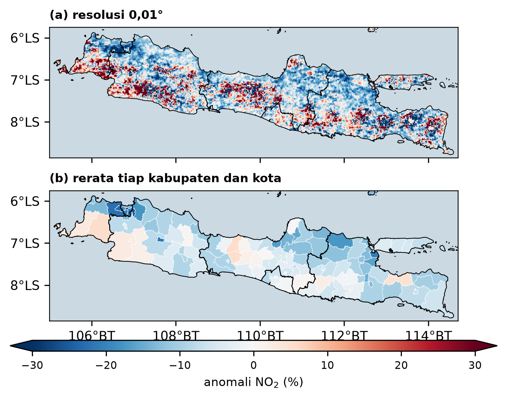
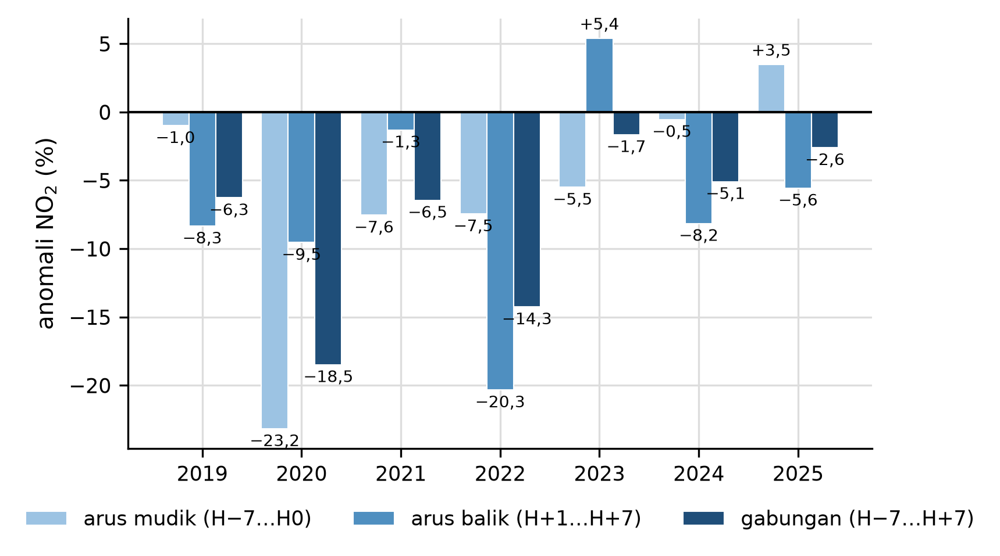

# How much does NO₂ over Java drop during Lebaran?

**Satellite analysis of tropospheric NO₂ over 117 regencies and cities in Java during Eid al-Fitr (Lebaran), 2019–2025.**

Undergraduate thesis, Meteorology, Institut Teknologi Bandung (2026), by Arya Perdana Putra Nasution.
Supervisors: Musa Ali Mustofa, S.Si., M.Si. and Rachmy Fitriani, S.Si., M.Si.


*NO₂ anomaly during the 15 days of Lebaran compared with normal days, 2019–2025 average: (a) at 0.01° grid resolution, (b) per regency and city. Blue means lower NO₂ than normal. Figure labels are in Indonesian, as in the original thesis.*

## The question

Lebaran is the largest population movement in Indonesia, and most of it happens in Java. Nitrogen dioxide (NO₂) comes mainly from burning fuel (traffic, power plants, industry) and only lasts a few hours in the air, so it reacts quickly when human activity changes. That makes it a useful marker of activity.

This project asks three things:

1. Where and by how much does NO₂ change across Java during Lebaran?
2. Is the change consistent from year to year, and which regions change the most?
3. Can rainfall or air temperature explain the change instead?

## The main challenge: a moving holiday

Eid follows the Hijri calendar and moves about **11 days earlier every year**. Between 2019 and 2025 it shifted from June to March, so a fixed calendar comparison (for example "April vs. April") would mix the Lebaran effect with the seasonal cycle of NO₂.

To avoid this, each year is compared with **normal days in the same season of that same year**:

| Period | Days relative to Eid (H0) |
|---|---|
| Lebaran (combined) | H−7 to H+7 (15 days) |
| Homecoming (*arus mudik*) | H−7 to H0 |
| Return (*arus balik*) | H+1 to H+7 |
| Reference (normal days) | H−60 to H−31 and H+30 to H+59 |

The anomaly for each region and year is `(Lebaran − reference) / reference × 100%`.

## Key findings

| Result | Value |
|---|---|
| Average NO₂ change across 117 regions, combined period | **−7.84%** |
| Years with a decrease (Java average) | **7 of 7** (Wilcoxon signed-rank, exact p = 0.0156) |
| Same result without 2020 (COVID-19 restrictions) | −6.06%, 6 of 6 years (p = 0.0313) |
| Land grid cells that decreased (0.01°) | 68.5% |
| DKI Jakarta | **−20.5%** (p = 0.0313) |
| Surabaya City | **−20.7%** (p = 0.0313) |
| Purbalingga / Ponorogo (destination regencies) | +5.0% / +2.0%, not significant |
| Rainfall and temperature correlation tests that were significant | 2 of 10, neither consistent with the decrease |


*Java-wide NO₂ anomaly per year for the homecoming (light), return (medium), and combined (dark) periods. The combined period decreased in every year.*

In short: NO₂ falls during Lebaran, the drop is concentrated in large cities, and rainfall and temperature do not explain it.

## Data

| Data | Source (Google Earth Engine collection) | Resolution |
|---|---|---|
| Tropospheric NO₂ column | Sentinel-5P TROPOMI, `COPERNICUS/S5P/OFFL/L3_NO2` | daily, ~3.5 × 5.5 km |
| Rainfall | CHIRPS, `UCSB-CHG/CHIRPS/DAILY` | daily, 0.05° |
| 2 m air temperature | ERA5-Land, `ECMWF/ERA5_LAND/DAILY_AGGR` | daily, 0.1° |
| Regency and city boundaries | FAO GAUL 2015 level 2 | polygons |

## Workflow

1. **Data extraction (Google Earth Engine).** `Script/ambil_data_gee.py` builds daily composites, removes negative NO₂ values (retrieval artefacts), clips them to Java, and exports averages per regency/city and per period. The exported files are already in `Data/01_mentah`, so this step does not need to be repeated.
2. **Analysis (Python).** `Script/analisis_no2_lebaran.py` (or the same steps in the Colab notebook `analisis_no2_lebaran.ipynb`) calculates the anomalies, runs the statistical tests, and draws every map and chart.
3. **Statistics.** Year-to-year consistency is tested with the Wilcoxon signed-rank test using the exact distribution, because seven years are too few to assume normality. The link with weather is checked with Pearson correlation at two scales: between regions and between days.

## Run it yourself

```bash
pip install -r requirements.txt
python Script/analisis_no2_lebaran.py
```

The script reads `Data/01_mentah`, writes tables to `Data/02_olahan` and figures to `Gambar/`. All key numbers are collected in `Data/02_olahan/ringkasan_angka.json`, and the output matches the thesis exactly.

## Repository structure

```
├── Data/
│   ├── 01_mentah/      raw exports from Google Earth Engine (inputs)
│   ├── 02_olahan/      processed tables, regenerated by the script
│   └── KAMUS_DATA.md   data dictionary (Indonesian)
├── Gambar/             all figures produced by the script
├── Script/
│   ├── ambil_data_gee.py          data extraction in Earth Engine
│   ├── analisis_no2_lebaran.py    full analysis and figures
│   └── analisis_no2_lebaran.ipynb same steps as a Colab notebook
└── BACA_DULU.md        detailed notes in Indonesian, including figure numbering
```

## Limitations

- Sentinel-5P measures the **tropospheric column** (all NO₂ above a point), not the concentration people breathe at ground level.
- The satellite passes once a day around 13:30 local time and cannot see through thick clouds, so some days are missing.
- The NO₂ retrieval algorithm changed on 1 July 2021 (v2.2). Removing 2021 does not change the conclusion (6 of 6 years still decrease, p = 0.0313).
- Only rainfall and temperature were tested. Wind, solar radiation, and boundary-layer height were not included.
- Regency-level traveller numbers were not available, so "origin" and "destination" labels are based on province-level data.

## Tools

Python (pandas, NumPy, SciPy, Matplotlib, tifffile), Google Earth Engine, Google Colab.

## Author

**Arya Perdana Putra Nasution**, Meteorology, Institut Teknologi Bandung
aryaanstt@gmail.com
